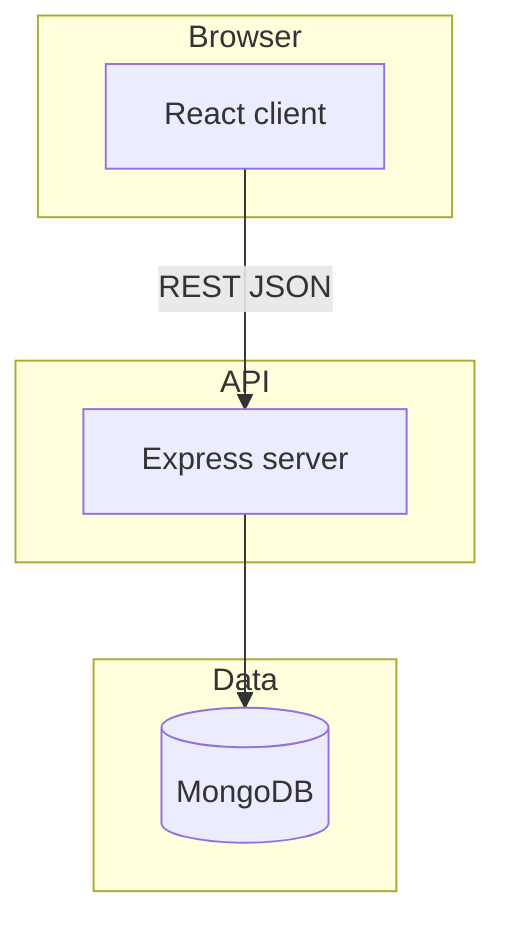

# SID Software Solutions

[](https://github.com/your-org/sid-software-solutions/actions/workflows/ci.yml)
[](./server/coverage)

Focused issue tracker for software teams — deterministic workflows, explicit permissions, and a calm interface.

## Screenshots

Place captures in `docs/screenshots/`:

- `login.png`
- `board.png`
- `dashboard.png`

## Features

- Role-based auth with rotating refresh tokens
- Projects, members, and per-project ticket keys (`SID-142`)
- Kanban board with optimistic drag-and-drop
- Table view, saved filters, text search, cursor pagination
- Comments, activity log, and in-app notifications
- Dashboard aggregations from MongoDB pipelines

## Stack

| Layer | Technology |
| --- | --- |
| Client | React 18, TypeScript, Vite, Tailwind, TanStack Query |
| Server | Express, Mongoose, Zod, JWT, bcryptjs, OpenAPI |
| Data | MongoDB 7 |
| Tests | Jest, Supertest, Vitest, Playwright, axe-core |

## Architecture



See [docs/ARCHITECTURE.md](./docs/ARCHITECTURE.md) and [docs/DECISIONS.md](./docs/DECISIONS.md).

## Quick start

### Docker Compose

```bash
cp .env.example .env
docker compose up --build
```

- Client: http://localhost:5173
- API: http://localhost:4000/api/health
- Swagger: http://localhost:4000/api/docs

### Local development

```bash
cp .env.example .env
npm install
npm run dev -w @sid-software-solutions/server
npm run dev -w @sid-software-solutions/client
```

### Seed demo data

```bash
npm run seed
```

## Environment variables

| Variable | Description |
| --- | --- |
| `MONGODB_URI` | Mongo connection string |
| `JWT_ACCESS_SECRET` | Access token HMAC secret (32+ chars) |
| `JWT_REFRESH_SECRET` | Refresh token HMAC secret (32+ chars) |
| `CORS_ORIGINS` | Comma-separated browser origins |
| `VITE_API_URL` | API base URL for the client build |

## Test commands

```bash
npm run lint
npm run type-check
npm run test
npm run test:e2e -w @sid-software-solutions/client
```

## API overview

Interactive OpenAPI UI: `/api/docs` on the running server.

## Deployment

1. Configure registry credentials (`SID_REGISTRY`, `SID_REGISTRY_TOKEN`).
2. Run the `Deploy` workflow on `main` after CI passes, or build locally:

```bash
docker build -f server/Dockerfile -t sid-software-solutions-server:latest .
docker build -f client/Dockerfile -t sid-software-solutions-client:latest .
```

3. Provide `MONGODB_URI`, JWT secrets, and `CORS_ORIGINS` in the target environment.

## Roadmap

- Saved view sharing per project
- CSV export for filtered ticket tables
- SAML SSO for enterprise workspaces

## Design decisions and trade-offs

Non-obvious product and engineering choices are recorded in [docs/DECISIONS.md](./docs/DECISIONS.md). UI tokens and component guidance live in [docs/DESIGN.md](./docs/DESIGN.md).
