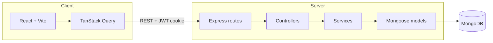

# Architecture

## Overview

SID Software Solutions is an npm workspaces monorepo with a React client and an Express API backed by MongoDB.

## Server layers

- **Routes** wire HTTP paths, rate limits, and authentication middleware.
- **Controllers** translate Express requests into service calls and shape JSON responses.
- **Services** enforce permissions, validation, and domain rules.
- **Models** define Mongoose schemas, indexes, and persistence boundaries.

Cross-cutting concerns live in `middleware/` (errors, request IDs, auth), `lib/` (logging, sanitization), and `permissions/rules.ts` for deterministic role checks.

## Client layers

Feature folders (`features/auth`, `features/board`, `features/tickets`) own screens and hooks. Shared presentation lives under `components/ui`. Server state is loaded exclusively through TanStack Query wrappers in `features/tickets/queries.ts`.

## Security model

- Short-lived JWT access tokens in the `Authorization` header.
- Rotating refresh tokens in an httpOnly cookie scoped to `/api/auth`.
- Role checks in services even when routes already use permission middleware.
- Markdown fields sanitized with `sanitize-html` before storage.

## Observability

`pino-http` logs each request with an `x-request-id` header. Health (`/api/health`) and readiness (`/api/ready`) endpoints support container orchestration.
